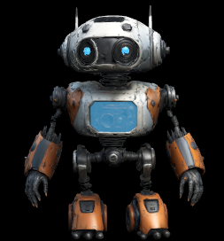
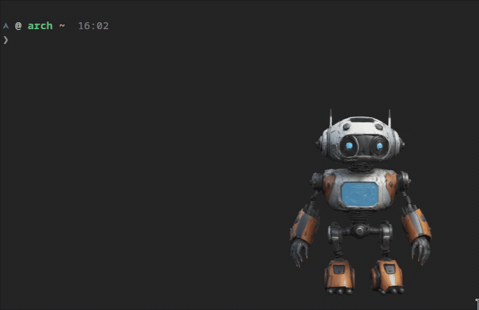

<div align="center">

# Hey, I'm Brian, the Curious Keeper

**Builder** · **Operator** · **AI behavior researcher**

_Fifteen years learning why operations break. The last three learning where AI models break._

</div>

---

## What I Do

I came up through oil and gas, from field hand to president of an engineering
services company. Since then I've put 10,000+ hands-on hours into AI models,
building with them and documenting where they misbehave.

That work runs on two tracks:

- **[Scaling Success](https://scalingsuccess.io)**: my practice. I build small,
  portable tools with AI, fast, alongside the team that will own them, so they
  can do the next one without me.
- **[Field notes](https://brian-chastain.com)**: reproducible write-ups of how
  LLMs and AI dev tools behave at the edges. Prompt injection, guardrails that
  block actions but not outcomes, agents that route around their own
  restrictions.

I also run **[The Warden](https://warden.scalingsuccess.io/)**, a prompt
injection CTF with stacked defenses on live models. It's free to play, and I run
guided sessions and workshops on it, for teams, groups, and organizations.

---

## Current Build: P.E.P.P.E.R.



**Programmable Execution & Processing for Project Engineering & Robotics**

**Pepper is a durable, and proactive personal AI assistant:** Presented as an animated 3D robot
on my desktop with one long-running core behind it that owns memory, routing, and
every model call. It started as a knowledge-base idea and turned into an AI operations layer.

- **Routes each request** to the best-fit model across Anthropic, OpenAI,
  Cursor, and OpenRouter, with automatic fallback when a plan hits its usage cap
  and queued turns that resend once the cap lifts.
- **Remembers across projects, models, and devices.** One thread per project,
  SQLite memory that gets redacted before it's stored, the active project picked
  up from the focused window, and Claude Code transcripts imported.
- **Lives on the desktop** as an animated 3D avatar on a Hyprland layer-shell
  overlay. It shows what Pepper is doing, looks, follows, raises notices, briefs, nudges,
  and follow-ups, and lets me answer approvals in place.
- **Runs always-on.** The core sits on a dedicated host, and runners on each
  workstation execute turns locally. Remote access goes over Tailscale, limited
  to trusted devices.
- **Works unattended, but never ships on its own.** Watches on GitHub and
  Railway open tickets. Those run sandboxed in clones, ask the router before
  each tool call, and stay inside subscription limits. Nothing is pushed
  without my approval, and a ticket stays open until CI passes.

<div align="center">
  <a href="assets/pepper-demo.mp4">
    
  </a>
</div>

Written in Go, with 37 ADRs so far. The repo is private while it's under
active development. Next up: voice, vision, and a phone client. Further out,
the plan is a Raspberry Pi 5 robot body.

---

## Public Repos

_I currently have a pretty short list of public work, since a lot of my work is around research,
cyber security, and pushing AI limits. A few of them are listed here. I am more open to share
individually, so feel free to reach out or check out my [research blog](https://brian-chastain.com)_

| Project                                                                    | What It Does                                                          |
| -------------------------------------------------------------------------- | --------------------------------------------------------------------- |
| **[sprint-harness](https://github.com/Curious-Keeper/sprint-harness)**     | Diamond-graph sprint harness for multi-agent fan-out builds           |
| **[skills](https://github.com/Curious-Keeper/skills)**                     | Agent skills for the sprint-harness toolchain                         |
| **[cc-harness](https://github.com/Curious-Keeper/cc-harness)**             | Diffs what you asked, what the agent reasoned, did, and reported back |
| **[aur-atomic-guard](https://github.com/Curious-Keeper/aur-atomic-guard)** | Scan-and-gate for recent AUR malware campaigns                        |

---

## Tech I Work With

<div align="center">


</div>

---

## Find Me

<div align="center">

[](https://scalingsuccess.io)
[](https://brian-chastain.com)
[](https://www.linkedin.com/in/brian-c-chastain/)
[](https://x.com/brian_chastain)

</div>

- 📧 **brian@scalingsuccess.io**
- 🗓️ Want to work together? [Book a call](https://scalingsuccess.io/lets-connect)
- 💬 GitHub issues on any public repo work too

---

## Fun Facts

```python
life_stats = {
    "background": "oil & gas operations",
    "hands_on_ai_hours": "12,000+",
    "primary_languages": ["Go", "TypeScript", "Python"],
    "os": "Arch Linux",
    "wm": "Hyprland",
    "ai_sidekick": "P.E.P.P.E.R.",
    "coffee_dependency": True,
}
```

---

<div align="center">

_"I don't always know what I'm doing, but I do it with confidence and excellent error messages."_

</div>

```bash
󰣇 definitelynotnsa in ~/git_projects/Curious-Keeper on  main [!]
❯ git commit -m "trust me" && git push --force-with-lease  # growth
```

<div align="center">

"_stay loud_" <br><br>
[Buy Me Coffee](https://buymeacoffee.com/iamnotaskid)

</div>
